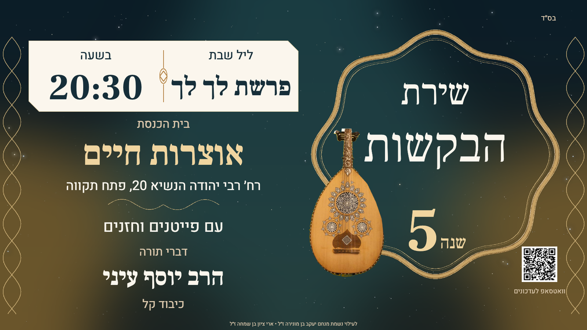

# Bakashot designs

Final green-and-gold designs for **שירת הבקשות**, in A4 and wide WhatsApp formats. This repository contains only the current approved versions, not the earlier experiments.

Download the complete collection as a [ZIP](https://github.com/michaellevy101/bakashot-design/archive/refs/heads/main.zip), or choose individual files below.

| Version | A4 | Wide / WhatsApp |
| --- | --- | --- |
| **Locked baseline** - approved design, without stars | [Image](versions/01-locked/A4/Poster.png) · [PowerPoint](versions/01-locked/A4/Editable.pptx) · [HTML editor](versions/01-locked/A4/Editor.html) | [Image](versions/01-locked/Wide/Poster.png) · [PowerPoint](versions/01-locked/Wide/Editable.pptx) · [HTML editor](versions/01-locked/Wide/Editor.html) |
| **Starry version** - denser night sky; larger oud and QR beside the title frame in the wide design | [Image](versions/02-starry/A4/Poster.png) · [PowerPoint](versions/02-starry/A4/Editable.pptx) · [HTML editor](versions/02-starry/A4/Editor.html) | [Image](versions/02-starry/Wide/Poster.png) · [PowerPoint](versions/02-starry/Wide/Editable.pptx) · [HTML editor](versions/02-starry/Wide/Editor.html) |
| **Weekly template** - blank parashah and rabbi names; everything else fixed | [Image](versions/03-weekly/A4/Poster.png) · [PowerPoint](versions/03-weekly/A4/Editable.pptx) · [HTML editor](versions/03-weekly/A4/Editor.html) | [Image](versions/03-weekly/Wide/Poster.png) · [PowerPoint](versions/03-weekly/Wide/Editable.pptx) · [HTML editor](versions/03-weekly/Wide/Editor.html) |

Every `Poster.png` is one complete, single-page image. Wide images are 1600 × 900. A4 folders also contain a monochrome `Print.png`, a single-page [PDF](versions/03-weekly/A4/Print.pdf), and `Print-editable.pptx`.

## Weekly editing

Download `Editor.html` and open it in a browser; GitHub does not run the editor directly. Only **שם הפרשה** and **שם הרב** are editable in the weekly templates. The time (20:30), location, address, other wording, and artwork remain fixed. Use the save button to download your updated self-contained HTML, or print it to PDF.

Weekly PowerPoints contain one fixed background and exactly two empty editable text boxes, named `parashah` and `rabbi`. Install the included [fonts](fonts/) before editing in PowerPoint. The HTML editors embed their fonts and images and work offline.

The locked baseline is the approved *design*; its text remains editable. Only the weekly templates restrict editing to the two names.

## Starry preview

## Photo and font credits

The oud photograph, ["Oud - MIM PHX"](https://commons.wikimedia.org/wiki/File:Oud_-_MIM_PHX.jpg), is by **Frank Kovalchek**, licensed under [CC BY 2.0](https://creativecommons.org/licenses/by/2.0/). It has been cut out, resized, and converted to grayscale for print. Attribution is retained here, in the editors, in PowerPoint notes, and in [PHOTO-LICENSE.txt](licenses/PHOTO-LICENSE.txt).

When sharing an image or PDF separately from this repository, include the photo attribution and license link in its accompanying message or caption. The photographer does not endorse the event.

Frank Ruhl Libre and Heebo are supplied with their respective SIL Open Font Licenses in [fonts/](fonts/). No blanket license is assigned to the complete poster designs.
